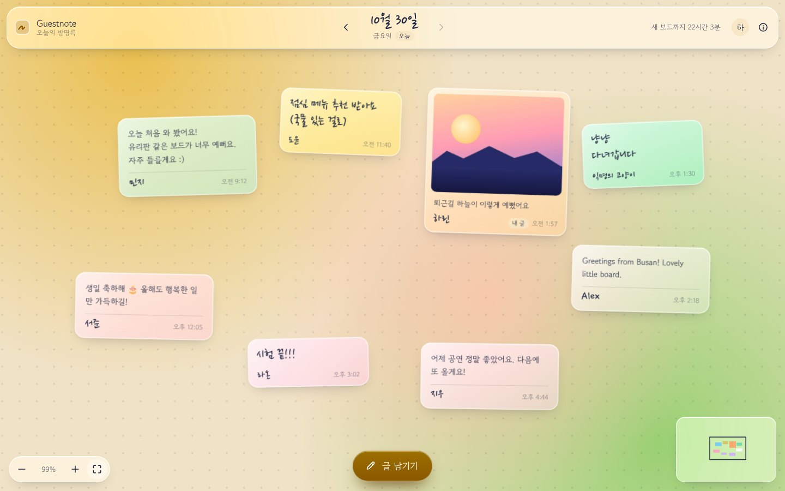

# Guestnote — 오늘의 방명록

날마다 새로 열리는 커다란 유리 보드에 방명록과 사진을 바로 써 붙이는 웹사이트예요.

**사이트:** https://meaterick.github.io/Guestnote/



## 기능

- **큰 보드**: 4000×2600 보드를 끌어서 둘러보고, 휠이나 두 손가락으로 확대·축소해요.
- **보드에 바로 쓰기**: 빈 곳을 두 번 누르거나 '글 남기기'를 누르면 그 자리에 글상자가 열려요. 창을 띄우지 않고 보드 위에 바로 쓴 뒤 Enter(또는 '올리기')를 누르면 올라가요. 줄을 바꾸려면 Shift+Enter를 눌러요. 모양은 기본이 글자만이고, 줄 그어진 메모장으로 바꿀 수 있어요. 색은 7가지예요. (글자는 잉크 색, 메모장은 유리 색)
- **사진 넣기**: 사진 버튼, 끌어다 놓기, 붙여 넣기(Ctrl+V)로 넣어요. 올리기 전에 브라우저에서 줄여서, 보드에는 작은 사진(긴 변 512px, 32KB 이하)이 보이고 큰 사진(1200px, 120KB 이하)은 '크게 보기'를 눌렀을 때만 불러와요. 글자(base64)가 아니라 바이트로 저장해서 공간을 25% 아껴요.
- **글 고르기**: 글을 한 번 누르면 아래 막대에 쓴 사람과 시간이 나와요. 내 글은 두 번 눌러 그 자리에서 고치고, 끌어서(또는 화살표 키로) 옮기고, 지울 수 있어요.
- **오늘만 쓰기**: 쓰기·옮기기·고치기·지우기는 오늘 보드에서만 돼요. 한국 시간 자정에 새 보드가 열리고, 지난 보드는 날짜를 눌러 달력에서 고르거나 `#/2026-10-28` 같은 주소로 열어 읽기만 해요. 관리자도 지난 보드는 읽기만 해요.
- **Google 로그인과 실시간**: 보드는 누구나 보고, 글을 남길 때만 Google로 로그인해요. 다른 사람이 남기거나 옮긴 글은 새로고침 없이 바로 보여요. 이메일은 보드에 나오지 않아요.
- **글쓰기 안내와 작성자**: 오늘 보드 왼쪽 아래에 빈 곳을 더블클릭하면 바로 쓸 수 있다는 작은 안내가 나와요. 휴대폰에서는 두 번 누르기로 안내해요. 작성자 앞의 대시는 없고, 새 글의 작성자는 Google 계정 이름으로 고정돼요(앞뒤 공백 제외, 20자까지, 이름이 없으면 '방문자'). 예전에 쓴 글을 고칠 때는 원래 작성자 이름을 유지해요.
- **프로필**: 오른쪽 위 동그라미를 누르면 화면 밝기 설정(기기 설정·밝게·어둡게)과 로그아웃만 나와요.
- **카카오톡·인스타그램 공유**: 링크를 보내면 미리보기 카드(`public/og.jpg`)가 떠요. 앱 안 브라우저에서는 Google이 로그인을 막아서, 대신 브라우저로 여는 버튼(카카오톡: 다른 브라우저로 열기, 아이폰: Safari로 열기)과 주소 복사를 보여 줘요.
- **글래스 디자인**: 날짜마다 배경 빛깔이 달라지고, 다크 모드와 휴대폰 화면을 지원해요.

## 구성

| 부분 | 내용 |
| --- | --- |
| 사이트 | `public/` 정적 파일. `main`에 올리면 GitHub Actions가 GitHub Pages로 배포해요. (Settings → Pages → Source: GitHub Actions) |
| 저장소 | Firebase 프로젝트 `note-5997b`의 Firestore(서울). 설정값은 [public/config.js](public/config.js)에 있어요. |
| 로그인 | Firebase Authentication의 Google 로그인. 승인된 도메인에 `meaterick.github.io`를 넣어 두었어요. |
| 보안 규칙 | [firebase/firestore.rules](firebase/firestore.rules): 누구나 읽기, Google로 로그인한 사람만 오늘 보드에 쓰기, 내 글만 고치기, 관리자는 오늘 보드의 글을 옮기거나 지우기, 지난 보드는 모두 읽기만, 사진 용량 제한 |

데이터는 `notes`(글과 작은 사진), `images`(큰 사진), `admins`(관리자 표시) 컬렉션에 저장돼요.

**운영 원칙**: 결제 수단 없이 무료 요금제(Spark)로 운영하고, 기록은 지우지 않고 영구 보관하며, 따로 백업하지 않아요.
- 무료 저장 공간 1 GiB에 사진 글은 약 7,000장 이상(1장에 많아야 약 150KB), 글자만 있는 글은 사실상 제한 없이 쌓여요.
- 하루 읽기 5만 번, 전송량 월 10 GiB를 넘으면 그날은 보드가 열리지 않고, 한국 시간 오후 4~5시에 다시 열려요. 요금은 나오지 않아요.
- 백업이 없어서 Firebase 콘솔에서 지운 데이터는 되돌릴 수 없어요. 콘솔에서 지울 때는 조심해 주세요.

## 관리

- **고친 내용 배포**: `main`에 올리면 1분 안쪽으로 사이트에 반영돼요.
- **보안 규칙 변경**: `firebase/firestore.rules`를 고쳤다면 Firebase 콘솔 → Firestore → 규칙에 붙여 넣고 게시해요.
- **관리자 등록**: Firebase 콘솔 → Authentication → 사용자 탭에서 내 계정의 사용자 UID를 복사해요. Firestore 맨 위(루트)에 `admins` 컬렉션을 만들고 그 UID로 문서를 만들어요. 필드는 `name: 관리자` 하나면 돼요. 관리자는 오늘 보드의 남의 글도 옮기거나 지울 수 있어요.
- **지난 글 지우기**: 지난 보드는 사이트에서 아무도 고칠 수 없어요. 꼭 지워야 하는 글은 Firebase 콘솔 → Firestore에서 그 글(`notes`)과, 사진이 있으면 같은 id의 큰 사진(`images`)을 지워요. 백업이 없어서 되돌릴 수 없어요.
- **시간대·사진 용량**: [public/config.js](public/config.js)에서 바꿔요. 시간대를 바꾸면 규칙의 `utcOffsetHours()`도 같이 바꾸고, 사진 용량을 늘리면 규칙의 상한(작은 사진 40,000바이트, 큰 사진 160,000바이트)도 늘려 주세요.
- **공유 미리보기**: 카카오톡이 예전 미리보기를 계속 보여 주면 [카카오 공유 디버거](https://developers.kakao.com/tool/debugger/sharing)에서 주소를 넣고 캐시를 초기화해요.

## 폴더

```
public/              배포되는 사이트 (index.html, config.js, assets/app.css, assets/js/)
firebase/            Firestore 보안 규칙과 색인 설정
tests/               날짜 단위 테스트, 보안 규칙 테스트, 브라우저 테스트
.github/workflows/   GitHub Pages 배포, 테스트
```

## 테스트

```bash
npm install
npx playwright install chromium
npm test
```

Firebase 에뮬레이터 위에서 보안 규칙과 화면 흐름(로그인, 보드에 바로 쓰기, 실시간 동기화, 드래그, 사진 넣기·붙여 넣기·끌어 놓기, 지난 기록 읽기, 자정 초기화, 휴대폰)을 확인해요. Java 21 이상이 필요하고, Google 로그인 창 스크립트를 받을 수 있게 인터넷이 연결돼 있어야 해요. `main`에 올릴 때마다 GitHub Actions에서도 자동으로 돌아가요.
