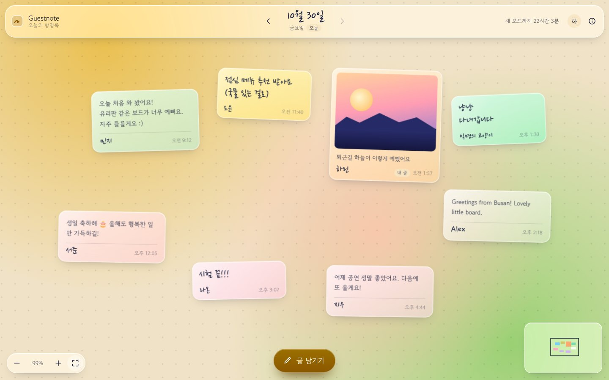

# Guestnote — 오늘의 방명록

날마다 새로 열리는 커다란 유리 보드에 방명록과 사진을 바로 써 붙이는 웹사이트예요.

**사이트:** https://meaterick.github.io/Guestnote/



## 기능

- **큰 보드**: 4000×2600 보드를 끌어서 둘러보고, 휠이나 두 손가락으로 확대·축소해요.
- **보드에 바로 쓰기**: 빈 곳을 두 번 누르거나 '글 남기기'를 누르면 그 자리에 글상자가 열려요. 휴대폰에서 두 번 톡 누르면 키보드까지 바로 올라와요. (남의 글자 글 위를 두 번 눌러도 그 자리에 새로 써요) 창을 띄우지 않고 보드 위에 바로 쓴 뒤 Enter(또는 '올리기')를 누르면 올라가요. 줄을 바꾸려면 Shift+Enter를 눌러요. 모양은 기본이 글자만이고, 줄 그어진 메모장으로 바꿀 수 있어요. 색은 7가지예요. (글자는 잉크 색, 메모장은 유리 색)
- **사진 넣기**: 사진 버튼, 끌어다 놓기, 붙여 넣기(Ctrl+V)로 넣어요. 올리기 전에 브라우저에서 줄여서, 보드에는 작은 사진(긴 변 512px, 32KB 이하)이 보이고 큰 사진(1200px, 120KB 이하)은 '크게 보기'를 눌렀을 때만 불러와요. 글자(base64)가 아니라 바이트로 저장해서 공간을 25% 아껴요.
- **움직이는 GIF**: 보드에서도 움직여요. 긴 변 480px·300KB 이하면 그대로 올리고, 더 크면 브라우저에서 긴 변 320px·300KB 이하로 줄여요. (색 255가지, 앞 장면과 같은 곳은 비워서 줄이고, 그래도 크면 크기를 더 줄이거나 장면을 건너뛰어요) 보드에는 첫 장면이 먼저 보이고, GIF를 불러오면 움직여요.
- **글 고르기**: 글을 한 번 누르면 아래 막대에 쓴 사람과 시간이 나와요. 내 글은 두 번 눌러 그 자리에서 고치고, 끌어서(또는 화살표 키로) 옮기고, 지울 수 있어요.
- **오늘만 쓰기**: 쓰기·옮기기·고치기·지우기는 오늘 보드에서만 돼요. 한국 시간 자정에 새 보드가 열리고, 지난 보드는 날짜를 눌러 달력에서 고르거나 `#/2026-10-28` 같은 주소로 열어 읽기만 해요. 관리자만 지난 글을 지울 수 있어요. (옮기거나 고치는 건 관리자도 못 해요)
- **지금 보는 사람**: 헤더와 창에는 나를 제외한 접속 수만 표시하고 이름은 표시하지 않아요. 탭별 기록을 계정 ID로 묶어 여러 탭은 한 사람으로 세요. 탭 전환·퇴장 때 기록을 지우고, 늦게 끝난 저장도 다시 정리해요. 강제 종료·통신 단절로 퇴장 요청을 보낼 수 없으면 마지막 기록에서 약 25~30초 안에 제외해요. 접속 중에는 10초마다 기록을 갱신해요.
- **로그인 없이 쓰기와 실시간**: 로그인 화면이 없어요. 처음 온 브라우저에는 Firebase 익명 로그인으로 보이지 않는 계정을 만들어서, 그 계정으로 '내 글'을 구분해요(같은 브라우저에서는 다음에 와도 같은 나예요). 사이트 데이터를 지우거나 다른 기기·브라우저로 오면 새 계정이라, 예전 글은 고칠 수 없어요. 다른 사람이 남기거나 옮긴 글은 새로고침 없이 바로 보여요.
- **내용만 표시**: 글과 사진에는 작성자 이름을 표시하지 않아요. 예전에 저장된 글과 사진, 글쓰기 창, 고른 글의 정보, 스크린리더 설명에도 이름은 나오지 않아요. 내 글 수정·삭제와 관리자 권한은 계정 ID로 유지해요.
- **설정**: 오른쪽 위 톱니바퀴에서는 화면 밝기(기기 설정·밝게·어둡게)만 정해요. 닉네임 입력과 ID 확인 기능은 없어요.
- **카카오톡·인스타그램 공유**: 링크를 보내면 미리보기 카드(`public/og.jpg`)가 떠요. 로그인이 없어서 카카오톡·인스타그램 앱 안 브라우저에서도 바로 글을 남겨요. 다만 앱 안 브라우저와 보통 브라우저는 저장 공간이 따로라서, 서로 다른 '나'로 구분돼요.
- **글래스 디자인**: 날짜마다 배경 빛깔이 달라지고, 다크 모드와 휴대폰 화면을 지원해요.

## 랜덤 여행 지도

오늘 보드 아래의 **랜덤 여행** 버튼으로 전국 지도를 열고 **여행지 뽑기**를 눌러요. 도시 목록 대신 남한의 육지 안에서 연속적인 좌표를 뽑아요. 제주·울릉도·독도와 데이터에 포함된 섬을 유지하고, 등적 투영과 rejection sampling으로 육지 면적에 비례해 뽑아요. 바다와 폴리곤의 구멍은 제외해요.

탐색 지점 이동, 잔상, 스캔, 핀 낙하·파동·입자와 확대 효과가 있어요. 동작 줄이기 설정에서는 즉시 결과를 보여 줘요. 결과는 지역명과 좌표로 표시하고, 지도에서 열기·좌표 복사·전국 보기를 지원해요. 계정·위치 권한이나 유료 지도 API가 필요하지 않아요. 지도는 처음 열 때만 불러와요.

`public/assets/data/korea-land.json`: [통계청 SGIS, 2018 / southkorea-maps](https://github.com/southkorea/southkorea-maps/tree/60c8c0cf0016381d80004d6b125760d6c5cb0605/kostat/2018/json), 공공누리 제1유형(출처표시). 원본의 모든 섬 폴리곤을 유지하며 약 15m 허용 오차로 경계를 단순화하고 소수점 6자리로 반올림했어요. 여행 계획을 위한 개략 지도이며 실제 접근성·해안선과 최신 행정경계는 상세 지도에서 확인해요.

지도와 추첨은 `travel-geo.js`, 화면과 효과는 `travel.js`·`travel.css`로 분리돼 있어요. 단위 테스트는 전국 육지 판정, 섬 포함, 5천 회 육지 추첨, 면적별 확률, 구멍 제외를 검사하고, 브라우저 테스트는 모바일·동작 줄이기·취소·재시도·다시 뽑기를 확인해요.

## 구성

| 부분 | 내용 |
| --- | --- |
| 사이트 | `public/` 정적 파일. `main`에 올리면 GitHub Actions가 GitHub Pages로 배포해요. (Settings → Pages → Source: GitHub Actions) |
| 저장소 | Firebase 프로젝트 `note-5997b`의 Firestore(서울). 설정값은 [public/config.js](public/config.js)에 있어요. |
| 계정 | Firebase Authentication의 익명 로그인 (콘솔 → Authentication → 로그인 방법 → 익명: 사용 설정). 방문자에게는 보이지 않아요. |
| 보안 규칙 | [firebase/firestore.rules](firebase/firestore.rules): 누구나 읽기, 익명 계정이 있는 사람만 오늘 보드에 쓰기, 내 글만 고치기, 관리자는 오늘 보드의 글을 옮기거나 지우기, 지난 보드는 모두 읽기만, 사진 용량 제한 |

데이터는 `notes`(글과 작은 사진), `images`(큰 사진), `admins`(관리자 표시), `profiles`(기존 보안 규칙과의 호환용 프로필), `presence`(지금 보는 사람) 컬렉션에 저장돼요.

**운영 원칙**: 결제 수단 없이 무료 요금제(Spark)로 운영하고, 기록은 지우지 않고 영구 보관하며, 따로 백업하지 않아요.
- 무료 저장 공간 1 GiB에 사진 글은 약 7,000장 이상(1장에 많아야 약 150KB), 움직이는 GIF 글은 약 3,000장(1장에 많아야 약 330KB) 쌓여요. 글자만 있는 글은 사실상 제한 없어요.
- 하루 읽기 5만 번을 넘으면 그날은 보드가 열리지 않고, 한국 시간 오후 4~5시에 다시 열려요. 전송량은 한 달 10 GiB까지라, 넘으면 다음 달까지 열리지 않아요. 움직이는 GIF는 보는 사람마다 내려받아서 전송량을 가장 많이 써요. 요금은 나오지 않아요.
- 백업이 없어서 Firebase 콘솔에서 지운 데이터는 되돌릴 수 없어요. 콘솔에서 지울 때는 조심해 주세요.

## 관리

- **고친 내용 배포**: `main`에 올리면 1분 안쪽으로 사이트에 반영돼요.
- **보안 규칙 변경**: `firebase/firestore.rules`를 고쳤다면 Firebase 콘솔 → Firestore → 규칙에 붙여 넣고 게시해요.
- **관리자 등록**: Firebase 콘솔 → Authentication → 사용자에서 관리자로 쓸 계정의 UID를 확인해요. Firestore 맨 위(루트)에 `admins` 컬렉션을 만들고 그 ID로 문서를 만들어요. 필드는 `name: 관리자` 하나면 돼요. 익명 계정은 그 브라우저(사이트 데이터를 지우지 않은 동안)에서만 관리자예요. 다른 기기에서도 쓰려면 그 기기의 ID도 같은 방법으로 넣어요. 관리자는 오늘 보드의 남의 글도 옮길 수 있고, 어느 날의 글이든 지울 수 있어요.
- **지난 글 지우기**: 관리자로 등록한 브라우저에서 지난 보드의 글을 누르고 '관리자로 지우기'를 눌러요. 사진이 있으면 큰 사진도 함께 지워져요. 백업이 없어서 되돌릴 수 없어요.
- **시간대·사진 용량**: [public/config.js](public/config.js)에서 바꿔요. 시간대를 바꾸면 규칙의 `utcOffsetHours()`도 같이 바꾸고, 사진 용량을 늘리면 규칙의 상한(작은 사진 40,000바이트, 큰 사진 160,000바이트, 움직이는 GIF 320,000바이트)도 늘려 주세요.
- **공유 미리보기**: 카카오톡이 예전 미리보기를 계속 보여 주면 [카카오 공유 디버거](https://developers.kakao.com/tool/debugger/sharing)에서 주소를 넣고 캐시를 초기화해요.

## 폴더

```
public/              배포되는 사이트 (index.html, config.js, assets/app.css, assets/js/)
firebase/            Firestore 보안 규칙과 색인 설정
tests/               날짜·GIF 단위 테스트, 보안 규칙 테스트, 브라우저 테스트
.github/workflows/   GitHub Pages 배포, 테스트
```

## 테스트

```bash
npm install
npx playwright install chromium
npm test
```

Firebase 에뮬레이터 위에서 보안 규칙과 화면 흐름(로그인 없이 보드에 바로 쓰기, 이름 없는 표시, 퇴장·여러 탭의 접속 수, 휴대폰에서 두 번 눌러 쓰기, 실시간 동기화, 드래그, 사진 넣기·붙여 넣기·끌어 놓기, 움직이는 GIF, 지난 기록 읽기, 자정 초기화)을 확인해요. GIF 읽기·쓰기는 브라우저 없이 따로 확인해요. Java 21 이상과, Firebase SDK를 받을 수 있게 인터넷 연결이 필요해요. `main`에 올릴 때마다 GitHub Actions에서도 자동으로 돌아가요.
